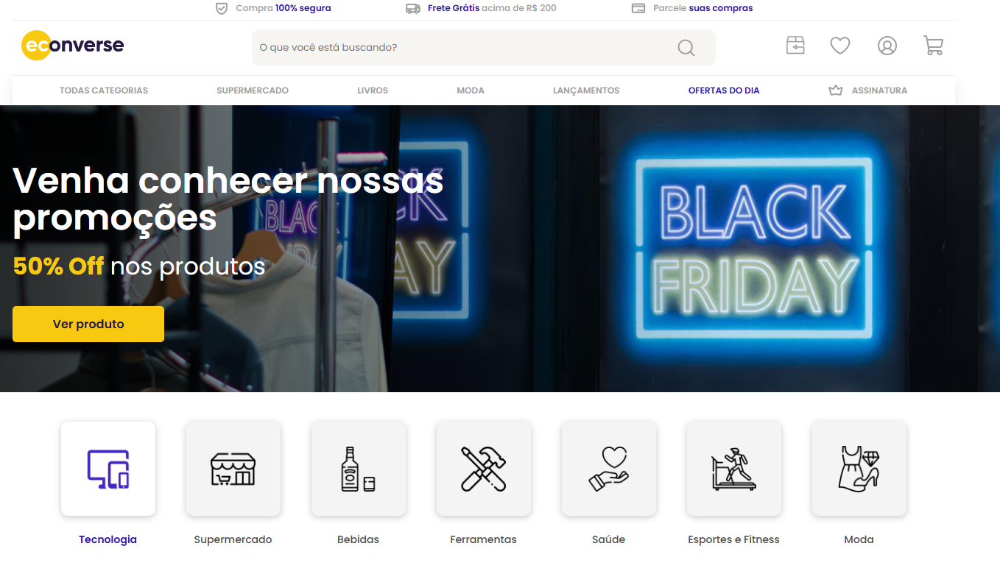

# 📌 Econverse - teste prático 

Este é um desafio técnico para o cargo de estagiário na empresa Econverse.
O desafio foi criar um site igual ao design disponibilizado pela empreza. 

<br>

## 🚀 Tecnologias utilizadas

* HTML 5
* CSS module (SASS)
* TypeScript
* Vite
* React
* React Router

<br>

## 📸 Preview



<br>

## 👤 Como interagir com o projeto

Acesse o [Link](https://teste-front-end-9jww.vercel.app/)

<br>

## ⚙️ Como rodar o projeto

```bash
# Clonar o repositório
git clone https://github.com/andressatomiozzo/teste-front-end.git


# Instalar dependências
npm install

# Rodar o projeto
npm run dev
```

<br>


## 🧠 Aprendizados

* SASS
* CreatePortal
* Carrossel no react

<br>

## 🛠️ Melhorias futuras

* [ ] Responsividade
* [ ] Testes automatizados
* [ ] Personalizar uma página de erro
* [ ] Dark mode


<br>

# ⭐ Contribuição

Sinta-se livre para contribuir, abrir issues ou sugerir melhorias para o projeto.